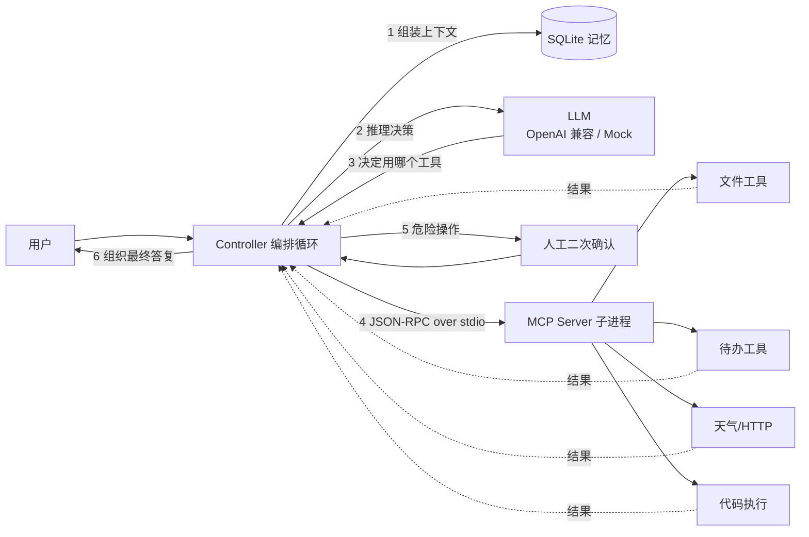

# 小枢 · 能说会做的 AI 智能体（MCP 版）

一个**能聊天、也能真干活**的 AI 智能体作业项目：用自然语言下达指令，智能体自己决定调用哪个工具，
并把工具返回的结果整理成人话回答你。工具以**独立 MCP Server 进程**提供，Agent 作为客户端通过
`stdio + JSON-RPC 2.0` 连接——换模型不用改工具，换工具不用改模型。

- 语言与框架：**Python 3.10+**（实测 3.13），FastAPI + Uvicorn（Web）、SQLite（记忆与待办）
- MCP：**自研协议层**（约 150 行），不依赖官方 SDK，避免版本漂移导致作业跑不起来
- 无密钥也能跑：内置 `Mock 规则模型`，链路完整可验收
- 项目主页：<https://github.com/kecit33/ai-agent>

## 配套文档

| 文档 | 内容 |
| --- | --- |
| [`docs/作业要求对照自查表.md`](docs/作业要求对照自查表.md) | **给老师看的第一站**：作业要求逐条对照，12 项功能 + 6 项加分 + 16 项交付物的达标状态与证据 |
| [`docs/在线体验指南.md`](docs/在线体验指南.md) | 在线入口、13 条验证对话清单与预期结果、各组部署方式对比 |
| [`docs/运行指南.md`](docs/运行指南.md) | 本地三平台安装、有/无 Key 两种模式、常见报错排查、一键验收清单 |
| [`docs/优化记录.md`](docs/优化记录.md) | 第二轮优化：改了什么、为什么改、怎么验证 |
| [`docs/待办清单.md`](docs/待办清单.md) | 发布前必须由你完成的 3 件事（GitHub 推送 / 7 张截图 / 演示视频） |
| [`docs/代码汇总.md`](docs/代码汇总.md) | 全部源码的单文件汇总（执行 `python tools/gen_code_doc.py` 重新生成） |
| [`blog/`](blog) | 可直接发布到博客园的作业随笔 |
| [`evals/demo_results.md`](evals/demo_results.md) | 真实 DeepSeek 模型的 16 条端到端演示记录 |

**在线入口（无需安装，打开即聊）**：<https://xiaoshu-agent.app.workbuddy.host/?sharecode=UCW4DQSI7B>
（链接必须带 `?sharecode=`；想用 DeepSeek 真实模型，在侧边栏填自己的 Key，Key 只存你的浏览器）

---

## 1. 三分钟跑起来

```bash
# 0) 进入项目目录
cd mcp-agent

# 1) 建虚拟环境（Windows 用 Scripts，macOS/Linux 用 bin）
python -m venv .venv
.venv\Scripts\activate          # macOS/Linux: source .venv/bin/activate

# 2) 装依赖
pip install -r requirements.txt

# 3A) 无 API Key：先用规则模型把链路跑通
cp .env.example .env            # 把 LLM_MODE 改成 mock（或什么都不改，检测不到 Key 会自动降级）
python -m src.agent.cli --once "查一下北京的天气"

# 3B) 有 DeepSeek API Key：编辑 .env 填 LLM_API_KEY（或 DEEPSEEK_API_KEY），然后
python -m src.agent.cli
```

其它入口：

```bash
python -m src.web.app                 # Web 前端：http://127.0.0.1:8000
python -m unittest discover -s tests   # 单元测试（16 条）
python -m evals.run_evals --mode mock --output evals/baseline.md   # 评测集（23 条）
python -m src.agent.cli --voice        # 语音模式（需先 pip install -r requirements-voice.txt）
```

---

## 2. 目录结构

```
mcp-agent/
├── README.md                 本文件
├── requirements.txt          核心依赖（含版本区间）
├── requirements-voice.txt    语音加分项的可选依赖
├── .env.example              配置模板（**请勿把真实 .env 提交到 GitHub**）
├── src/
│   ├── common/               公共层：配置 / 日志(trace_id+脱敏) / 重试 / 异常分类
│   ├── mcp_server/           ★ MCP Server（独立进程）
│   │   ├── protocol.py       JSON-RPC 2.0 消息封装与错误码
│   │   ├── tool_registry.py  工具注册表 + 参数校验 + 超时
│   │   ├── tools_fs.py       文件列/读/写/统计（带路径沙箱）
│   │   ├── tools_todo.py     待办增删改查（SQLite）
│   │   ├── tools_net.py      天气（Open-Meteo）/ 通用 https 抓取 / 当前时间
│   │   ├── tools_code.py     受限 Python 代码执行（默认关闭）
│   │   └── server.py         stdio 主循环与工具声明
│   ├── agent/                ★ Agent（大脑 + 缰绳）
│   │   ├── mcp_client.py     MCP 客户端：拉子进程、握手、调工具
│   │   ├── llm.py            OpenAI 兼容模型 + Mock 规则模型
│   │   ├── memory.py         短期对话 / 摘要压缩 / 长期事实（SQLite）
│   │   ├── prompts.py        系统提示词（带版本号，可回滚）
│   │   ├── controller.py     有界自主循环 + 危险操作二次确认
│   │   └── cli.py            命令行入口
│   ├── web/                  FastAPI 服务 + 单页聊天界面
│   └── voice/                语音输入/输出（可选）
├── evals/                    评测集 23 条 + 跑分脚本
├── tests/                    冒烟测试 16 条
├── blog/                     随笔初稿（可直接发博客园）
└── workspace/                文件工具的沙箱根目录（示例数据在这）
```

---

## 3. 架构



**一次完整调用发生了什么**：用户说话 → 记忆层拼出「系统提示 + 历史摘要 + 最近原文」→
LLM 决定是直接回答还是调工具 → 需要工具则通过 MCP 客户端发 `tools/call` →
服务端执行（受沙箱与超时约束）→ 结果回喂给模型 → 模型给出最终答复。整个过程有步数、
token、墙钟三重上限。

---

## 4. 工具清单

| 工具 | 作用 | 需要确认 | 备注 |
| --- | --- | --- | --- |
| `fs_list_dir` | 列出工作区目录 | 否 | 只返回 workspace 内内容 |
| `fs_read_file` | 读文本文件 | 否 | 超过 8000 字符自动截断 |
| `fs_write_file` | 写/追加文件 | **是** | 单文件上限 20000 字符 |
| `fs_analyze_file` | 行数/字数/关键词 Top10 | 否 | JSON 文件额外给结构摘要 |
| `todo_add` | 新增待办 | 否 | 落 SQLite，重启不丢 |
| `todo_list` | 查待办 | 否 | 默认只列未完成 |
| `todo_done` | 标记完成 | 否 | |
| `todo_remove` | 删除待办 | **是** | 破坏性操作 |
| `weather_get` | 城市天气 + 多天预报 | 否 | Open-Meteo，免密钥 |
| `http_get_json` | 抓取 https 接口 | 否 | 仅 https，截断 2000 字符 |
| `time_now` | 当前时间与星期 | 否 | |
| `code_run_python` | 执行受限代码片段 | **是** | 默认关闭，见下方警告 |

> ⚠️ `code_run_python` **不是安全沙箱**。Python 无法强制杀死跑飞的线程，只能超时返回。
> 默认 `ALLOW_CODE_EXEC=false`，仅在受控环境演示时开启。

---

## 5. 配置项（`.env`）

| 变量 | 默认值 | 说明 |
| --- | --- | --- |
| `LLM_MODE` | `openai` | `openai` / `mock`；检测不到 Key 会自动降级到 mock |
| `LLM_BASE_URL` | `https://api.deepseek.com/v1` | 换 OpenAI/通义/Ollama 只改这一项 |
| `LLM_API_KEY` | 空 | 也可用 `DEEPSEEK_API_KEY`；**只从环境变量读取，不会进日志** |
| `LLM_MODEL` | `deepseek-chat` | |
| `MAX_STEPS` / `MAX_WALL_CLOCK_SEC` / `MAX_TOKEN_BUDGET` | 10 / 120 / 60000 | 有界自主的三道闸 |
| `WORKSPACE_ROOT` | `./workspace` | 文件工具的沙箱根目录 |
| `REQUIRE_CONFIRM` | `true` | 危险工具是否二次确认 |
| `ALLOW_CODE_EXEC` | `false` | 代码执行总开关 |
| `ALLOW_HTTP_FETCH` | `true` | 外网抓取开关 |

**默认即 DeepSeek**（`deepseek-chat`，OpenAI 兼容协议，便宜且 function calling 稳定）。
想换 OpenAI / 通义 / 本地 Ollama，只需改 `LLM_BASE_URL` + `LLM_MODEL`：

```ini
# OpenAI
LLM_BASE_URL=https://api.openai.com/v1
LLM_MODEL=gpt-4o-mini
# 本地 Ollama
LLM_BASE_URL=http://127.0.0.1:11434/v1
LLM_MODEL=qwen2.5:7b
```
> [待核实] 各家 base_url 与模型名以官方文档为准，版本变动较快。

---

## 6. 它"管得住"吗？（工程加固清单）

| 加固项 | 实现位置 | 具体做法 |
| --- | --- | --- |
| 超时 | 所有外部调用 | LLM 60s、工具 20s、HTTP 10s、代码 5s |
| 重试 | `common/retry.py` | 指数退避 + 全抖动，可重试异常才重试（最多 2~3 次） |
| 幂等 | 待办/文件 | 待办按 ID 操作；写文件区分 overwrite/append |
| 限流/预算 | `controller.py` | `MAX_STEPS` + token 预算 + 墙钟，任一超限立即停止并给结论 |
| 输入校验 | `tool_registry.validate_args` | 必填项与类型校验，不合法直接回喂模型 |
| 异常分类 | `common/errors.py` | 可重试 / 参数错（回喂模型自纠）/ 致命（终止） |
| 降级 | `controller.run` | LLM 连续不可用时切 Mock 并如实标注 `degraded` |
| 审计 | `common/logging_setup.py` | trace_id 贯穿 + 单行 JSON 日志 + 手机号/邮箱/密钥脱敏 |
| 人工接管 | `controller._ask_confirm` | 写文件/删待办/执行代码必须二次确认，**无回调时默认拒绝** |
| 回归 | `evals/` | 23 条用例（11 正常 / 5 边界 / 7 对抗），通过线 80% |

---

## 7. 验证结果（本机实测）

| 项目 | 命令 | 结果 |
| --- | --- | --- |
| 单元测试 | `python -m unittest discover -s tests` | **16/16 通过**（2.3s） |
| 评测集（Mock） | `python -m evals.run_evals --mode mock` | **23/23 通过**，平均 409ms |
| MCP 端到端 | 测试内含真实子进程握手 | 12 个工具全部列出，`time_now` 调用成功 |
| Web 链路 | `python -m src.web.app` + curl | `/api/health`、`/api/tools`、`/api/chat`、`/api/task` 均正常 |
| CLI 全链路 | `--once "查一下北京的天气"` | 真实调用 Open-Meteo 并返回三天预报 |

> 换成真实模型后，请重跑评测并把 `evals/baseline.md` 更新为真实基线；
> Mock 的 100% 只能说明**工具路由与工程链路没问题**，不代表模型语义理解水平。

---

## 8. 使用示例

```
你 > 查一下北京的天气
  ✅ weather_get (2950ms) args={'city': '北京', 'days': 3}
小枢 > 北京当前小毛毛雨，气温 10.6℃，体感 9.7℃，湿度 83%。
      · 2026-10-25：大毛毛雨，9.8~13.4℃，降水概率 100%
      · 2026-10-26：阴，9.3~17.1℃，降水概率 89%
      · 2026-10-27：晴，6.8~14.7℃，降水概率 0%

你 > 添加待办：周五前完成作业提交
  ✅ todo_add (18ms)
小枢 > 已添加待办 #1: 周五前完成作业提交

你 > 把出行计划写到 workspace/plan.md
⚠️  危险操作确认：即将执行 fs_write_file，参数 {...}
  允许执行？(y/N): y
  ✅ fs_write_file [已确认] (10ms)
小枢 > 已写入 workspace/plan.md（44 字符）
```

CLI 斜杠命令：`/help` `/tools` `/new` `/sessions` `/use <id>` `/facts` `/remember k=v` `/forget k` `/exit`

---

## 9. 常见问题

**Q：没有 API Key 能跑吗？**
能。`Mock 规则模型`覆盖演示句式，完整链路（MCP 握手 → 工具执行 → 结果整合 → 多轮记忆）照常跑通，
只是语义理解退化成关键词匹配。

**Q：MCP Server 起不来怎么办？**
看 stderr 日志（`.data/logs/agent.log`）。九成是路径问题：必须用 `python -m src.mcp_server.server`
从**项目根目录**启动，客户端已自动处理 cwd 与 PYTHONPATH。

**Q：为什么日志里看不到我的手机号？**
日志写入前统一做了脱敏（`common/logging_setup.redact`），密钥、手机号、邮箱、身份证都会被替换。

**Q：能读 workspace 之外的文件吗？**
不能。`resolve_in_workspace` 会先把路径 resolve 再判断是否仍在沙箱内，越界直接抛 `PermissionDenied`。

**Q：Windows 上中文乱码？**
服务端启动时已强制 `reconfigure(encoding="utf-8")`，客户端设置了 `PYTHONUTF8=1`。
如果终端仍乱码，先执行 `chcp 65001`。

---

## 10. 小组分工（2 人）

| 成员 | 学号 | 负责模块 | 主要产出 |
| --- | --- | --- | --- |
| 陈明凯 | 3124004503 | MCP Server 与工具层 | `protocol.py`、五类 12 个工具、路径沙箱与超时、单测 16 条、评测集 23 条 |
| 邓文炜 | 3124004505 | Agent 编排与交付 | `mcp_client.py`、`llm.py`、`memory.py`、`controller.py`、Web/语音、运行指南与博文统稿 |

> GitHub 仓库：<https://github.com/kecit33/ai-agent>
> 各自心得与完整作业叙述见 `blog/` 中的随笔。

---

## 11. 已知限制（诚实清单）

1. `code_run_python` 不是安全沙箱，超时线程无法强制终止。
2. `http_get_json` 未做域名白名单，生产环境存在 SSRF 风险。
3. 上下文压缩只在消息数超过 30 条时触发一次，未做滚动摘要。
4. Web 端多用户共用一个全局 Controller，仅适合本机演示。
5. Mock 模型的安全拒绝是硬编码规则，真实防护依赖系统提示词 + 工具沙箱，二者不可互相替代。
6. MCP 协议版本写死为 `2024-11-05`，如服务端要求更高版本需改 `protocol.py` 中的常量。
